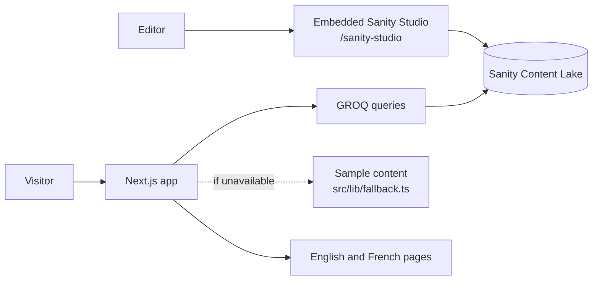

# Personal site

A bilingual personal site and CV. I built it as a side project to learn one stack end to end: Next.js, TypeScript, and Tailwind for the app, Sanity for the content, and Vercel for deployment.

The public pages are a short landing page, a full CV, and a page for each project, in English and French. I edit the words in Sanity Studio. This repository holds the app, the schemas, and the queries.

A fresh clone renders sample content from `src/lib/fallback.ts` until a Sanity project id is set. That sample is a fictional profile, so the layout can be reviewed without credentials. The published site replaces it with the documents in Sanity.

## What the site does

- **Landing page** (`/en`, `/fr`). Name, headline, and a summary that appears one word at a time as you scroll, then experience and skills.
- **CV** (`/en/cv`, `/fr/cv`). Summary, experience, projects, education, skills, and contact.
- **Project pages** (`/en/projects/[slug]`). A short case study stored as Portable Text.
- **Language.** English and French. A cookie remembers the choice. The request proxy sends `/` to `/en` or `/fr`, and leaves `/sanity-studio` outside that redirect.
- **Theme.** Light and dark, stored in this browser.
- **Editor.** Sanity Studio is mounted in the same app. The default path is `/sanity-studio`, from `NEXT_PUBLIC_SANITY_STUDIO_BASE_PATH`.

## Stack

- [Next.js](https://nextjs.org) App Router and React
- TypeScript
- Tailwind CSS
- [Sanity](https://www.sanity.io) and `next-sanity` for content and the embedded Studio
- [Vercel](https://vercel.com) for hosting

## Architecture



The public site and Studio are routes in the same Next.js app. Studio writes content to Sanity, while server components read it through GROQ queries and render the localized pages. If Sanity is not configured or cannot be reached, the app uses its local sample content.

## How a page is built

Sanity holds the documents. The app only knows the project id and the dataset name.

1. A document is published in Studio. Sanity stores it in the Content Lake.
2. A server component calls `getCv` in `src/lib/cv.ts`. That function runs a GROQ query from `sanity/lib/queries.ts` and passes the locale, `en` or `fr`.
3. The query reads the field for that language. When the French value is missing, GROQ uses English (`coalesce`).
4. The server turns the JSON into HTML and caches it for about 60 seconds (`revalidate = 60`). A publish shows up on the site inside that window, with no new deploy.

The schemas in `sanity/schemaTypes` are the forms the editor shows:

| Document | What it holds |
| --- | --- |
| Profile | Name, headlines, summaries, email, and links. One document, id `profile`. |
| Experience | Roles, ordered by `sortOrder`. |
| Project | Title, slug, summary, case study, stack, and links. |
| Education | School, credential, and coursework. |
| Skill category | A title and a list of skills. |

Translated text is one object with `en` and `fr` keys (`sanity/schemaTypes/localized.ts`). The same document serves both languages.

The site reads Sanity without an API token, so the dataset is public. Studio still requires a Sanity login. If the project id is missing or the fetch fails, `getCv` returns the sample CV and the page stays usable.

## Run it locally

```bash
npm install
cp .env.example .env
npm run dev
```

Open http://localhost:3000. The site redirects to `/en`. The editor is at http://localhost:3000/sanity-studio.

Next.js reads `NEXT_PUBLIC_` values when the dev server starts. Restart `npm run dev` after changing `.env`.

## Deploy on Vercel

Vercel clones this repository and runs `npm run build`. The same app that runs locally is the app that gets hosted.

1. Import the repository in Vercel.
2. Add the variables from `.env.example`. The Studio name, window title, and path are `NEXT_PUBLIC_SANITY_STUDIO_NAME`, `NEXT_PUBLIC_SANITY_STUDIO_TITLE`, and `NEXT_PUBLIC_SANITY_STUDIO_BASE_PATH`.
3. Deploy.

`NEXT_PUBLIC_` values are copied into the build. After you change them in the Vercel project, deploy again so the new values are included. The editor is then at `https://<your-domain>/sanity-studio`.

Add that site origin in the Sanity project CORS settings and allow credentials. CORS checks the origin, so one entry covers the CV and Studio.

## Connect Sanity

1. Create a free project at https://www.sanity.io/manage.
2. Copy the project id into `.env` for both `NEXT_PUBLIC_SANITY_PROJECT_ID` and `SANITY_STUDIO_PROJECT_ID`. Next.js reads the first name. The Sanity CLI reads the second. The dataset defaults to `production`.
3. Make the dataset public so the site can read it:

   ```bash
   npx sanity dataset visibility set production public
   ```

4. Add `http://localhost:3000` as a CORS origin and allow credentials. Add the Vercel URL the same way once it exists.
5. Open `/sanity-studio`, publish Profile, then add experience, projects, education, and skill categories.
6. Restart the dev server. A cached Sanity response lasts about 60 seconds.
